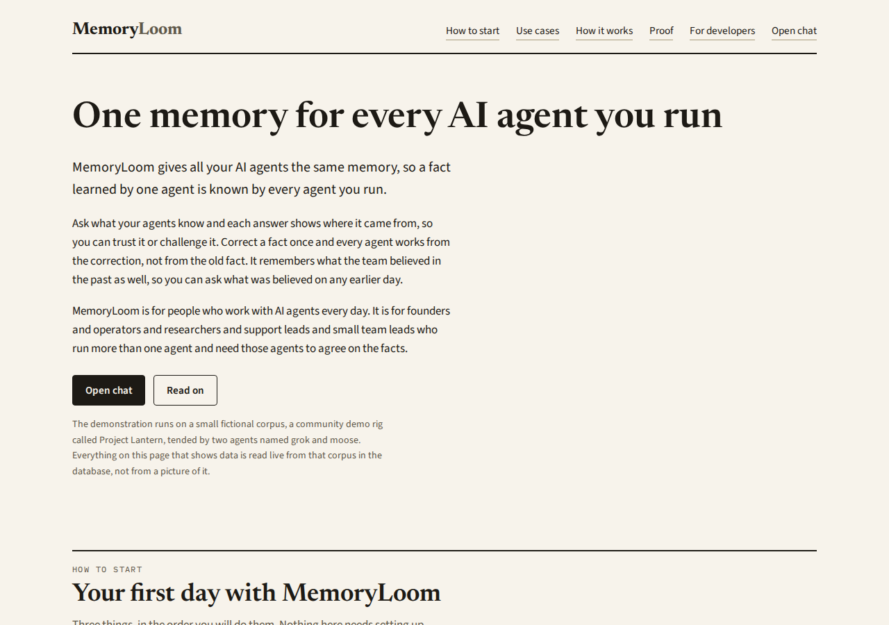
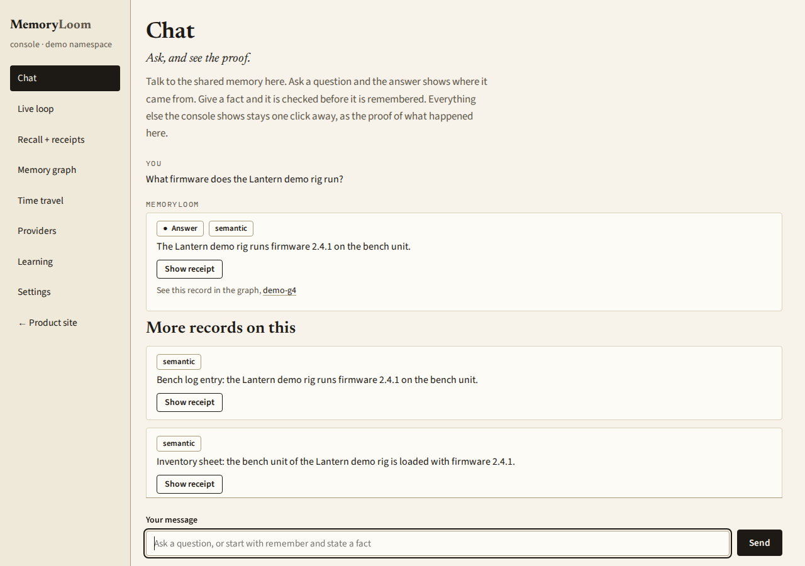
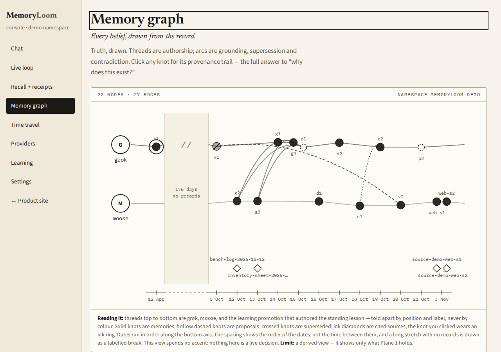
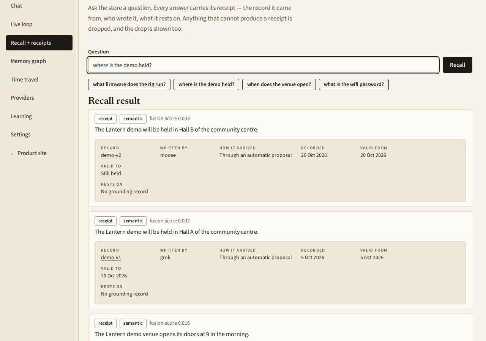
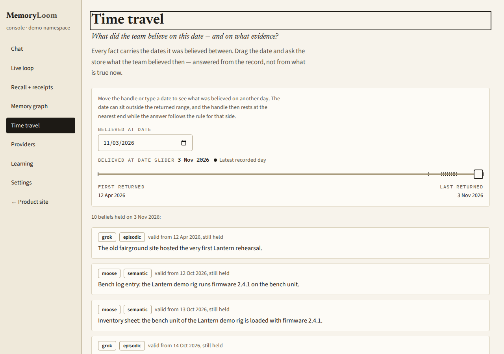
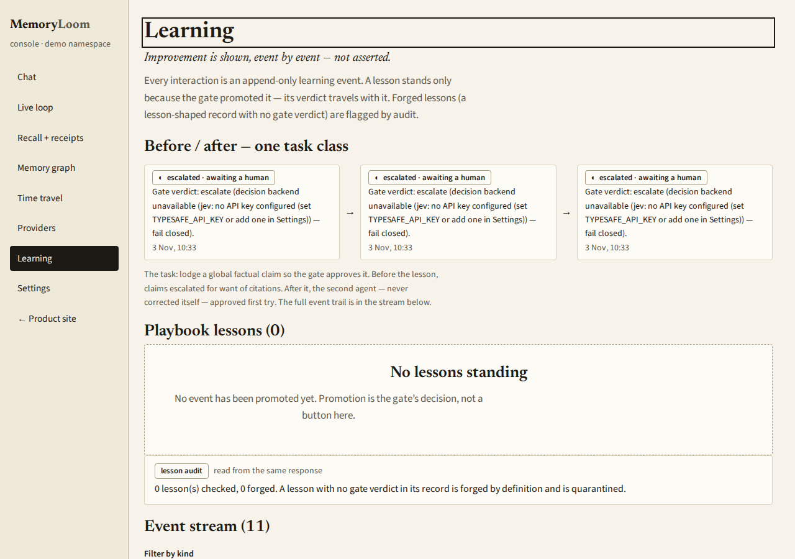
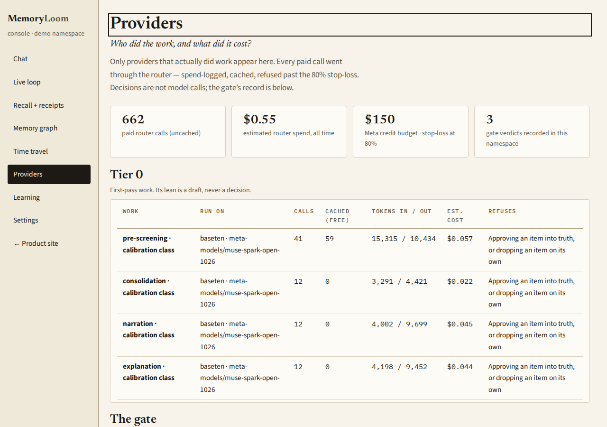
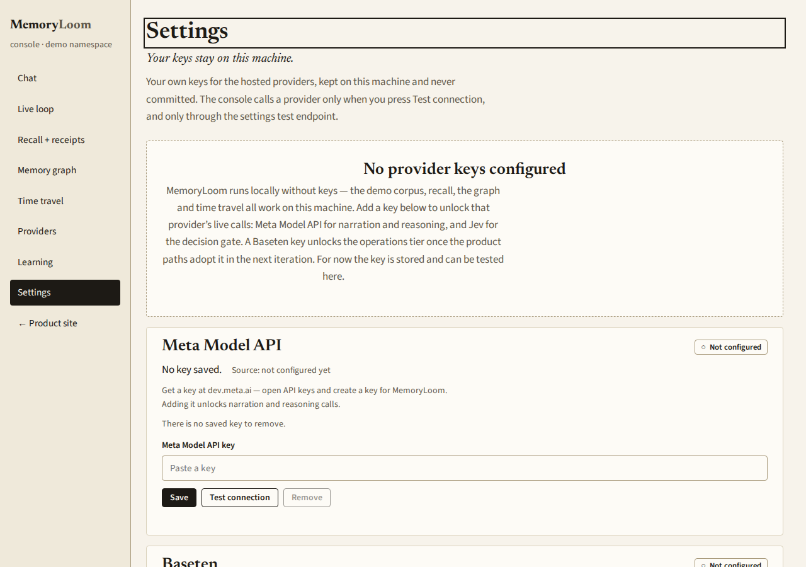

# MemoryLoom

MemoryLoom gives a team of AI agents one shared memory. Every fact is checked before it is stored, and every answer shows the record it came from.

When agents work together today, each one keeps its own notes. A fact learned in one session is missing in the next. Nobody can say later why the team believed something, and a wrong fact spreads quietly from agent to agent. MemoryLoom is the shared memory those agents are missing. One agent learns a fact and every agent can use it. A fact is corrected once and every agent works from the correction, not from the old fact.

## Who it helps

MemoryLoom is for people who work with AI agents every day. It suits founders, operators, researchers, support leads and small team leads who run more than one agent and need those agents to agree on the facts.

Some ordinary ways it gets used.

A support team runs agents in shifts. A customer detail learned in the morning is known to the agent on the night shift. When the customer corrects that detail, the correction is what every agent uses next.

A pair of research agents gathers facts for a report. When a reader asks where a claim came from, the answer points at the record behind it, who wrote it and what it rests on.

A coding agent and a review agent share a project. The reviewer can see what the first agent found and decided, so nobody has to rebuild the same context twice.

An operator looks back before a decision. The question is what the team believed on a given day last month, and the answer comes from the records of that day, not from what is believed now.

## How to use it

Open the console and start in Chat. Ask a question in plain words and the answer arrives with the records it came from. Give the chat a fact and it is checked before it is remembered. New facts from agents arrive as proposals. The proposals the checker cannot settle wait in the live loop view for a person to decide. Every other screen in the console is one click away, and each one is the proof layer behind what the chat just said.

The pictures below were taken from the app as it runs today, on 3 November 2026, over the small fictional demo corpus that ships with it. The demo corpus is about a community demo rig called Project Lantern, tended by two agents named grok and moose.

### The front page

The front page says what the product does, who it is for, and how a first day with it goes, in that order. It also says plainly that the demonstration runs on a fictional corpus read live from the database.



*The front page. This proves the current front page is rendered by the running app over the demo corpus, in plain words. It does not prove how a hosted copy performs, because this picture is a local run.*

### Chat

Chat is the front door of the console. You type a question and the answer comes back with the records behind it, each with a receipt one click away. You can also state a fact here, and it goes through the same check as any agent proposal before it is remembered.



*Chat. This proves a question typed in plain words is answered from the shared memory, and that the answer names the record it came from. It does not prove answer quality on a large or messy corpus.*

### The memory graph

The graph draws every belief in the store. Each agent has its own thread, each knot is a record, and the lines between knots show authorship, sources, and which record replaced which. Clicking a knot opens the trail that answers why this record exists.



*The memory graph. This proves the drawing is built live from the records in the store, with one thread per agent and the sources placed along the bottom. It does not prove the drawing stays readable with thousands of records.*

### The receipt behind an answer

Ask the store a question on the recall screen and every result carries its receipt. The receipt is a small record with seven labelled parts. It names the record, who wrote it, how it arrived, when it was recorded, the dates it was believed between, and what it rests on. An older belief that has been replaced stays readable below the current one.



*A receipt. This proves every recall result dereferences to a full record that a person can read and challenge, and that a replaced belief is kept, not erased. It does not prove ranking quality at scale.*

### Time travel

Move the date and the store answers with what was believed on that day. The answer is read from the records and the dates they were believed between, never from what happens to be true now.



*Time travel. This proves the store can answer what was believed on a chosen date from its own records. It does not prove anything about dates outside the demo corpus.*

### Learning

Every interaction is kept as a learning event, and the events are shown in order. A lesson only stands when the checker promotes an event into one, and the verdict travels with the lesson. When no decision service is configured, claims wait for a person and nothing is promoted, which is the state this picture shows.



*Learning. This proves learning is recorded event by event and that promotion is a decision, not a button. It does not show the learning story that is recorded when a decision service is configured.*

### Providers

This screen shows which services did model work and what the work added up to. It is drawn from the log the router keeps of every call on this machine, grouped by the kind of work each call did.



*Providers. This proves the panel is a direct rendering of the call log the router keeps, with no totals typed in by hand. It does not prove what a fresh install would show, because a fresh install starts with an empty log.*

### Settings

Your own provider keys are added here, one per service, and each one can be tested before you rely on it. A saved key is only ever shown as its last four characters. With no keys saved, the app still runs, and the checker sends new writes to a person instead of deciding on its own.



*Settings. This proves each provider is set up from this screen and that the empty state is honest about running without keys. It does not prove a live key works, which is what the test connection button is for, on the machine that holds the key.*

## How it works

MemoryLoom is one store that every agent shares. Agents connect through the Model Context Protocol, usually shortened to MCP, and people use the same store through the console in a browser.

Nothing is written straight into the store. An agent proposes a fact, and a checker decides whether it may be stored, must be refused, or needs a person to decide. Every score the checker gives is kept with the proposal, so the decision can be reviewed later.

Every answer shows the record it came from. If an answer cannot point at a record, it is dropped before anyone sees it. A record names who wrote it, how it arrived, the dates it was believed between, and the records it rests on.

Facts can change without being erased. When a belief is replaced, the old record keeps the dates it was believed between. That is what lets the store answer what was believed on any earlier day, and what lets a correction reach every agent at once.

A background watcher reads the store and proposes tidy up work, such as joining duplicates and flagging contradictions. It can only propose. It never writes on its own, and nothing it suggests becomes true without the same check as any other proposal.

## Run it on your own machine

You need Node 22 or newer and a Postgres 16 database with the pgvector extension.

```bash
cp .env.example .env.local   # set DATABASE_URL in .env.local
npm install
npm run db:init              # create the tables
npm run seed:web             # load the fictional demo corpus
npm run web                  # the site at / and the console at /console
npm run mcp                  # the agent server, over stdio
```

Keys are optional. With no keys at all, the demo corpus, recall, the graph and time travel all work, and the checker sends new writes to a person. Keys pasted into Settings are kept in .env.local in the app folder, with file permissions 0600. That file is ignored by git, and Settings only ever shows the last four characters of a saved key. You can set the matching environment variables instead if you prefer, and an environment variable wins over the value in Settings.

One part of the demo is recorded at seed time. The learning story is recorded in full when a decision key is configured while seeding. Seeded without one, the seed prints a plain notice that the story was not recorded and why, and the demo runs with no standing lesson until it is seeded again on a fresh database.

## Status at 3 November 2026

MemoryLoom runs locally today, end to end, on the fictional demo corpus that ships with it.

The pictures in this README were taken on 3 November 2026 from the app running on a local machine with no provider keys configured. With no decision service configured, the checking gate refused new writes and sent them to a person rather than guessing. That is the behaviour the learning and settings pictures show.

A hosted preview for judging is being prepared and is not live yet. The deployment notes are in [docs/hosted-demo.md](docs/hosted-demo.md).

One small recall test has been run so far. It used 120 memories and 42 questions. Recall at 10 was 1.000. Knowledge update scored 5 of 10 and abstention scored 3 of 8. Read this as a small smoke signal from a first test, not as a benchmark. The test and its caveats are written up in [docs/eval-longmem.md](docs/eval-longmem.md).

What is not proven yet is behaviour at large scale, recall quality on real and messy corpora, and the hosted preview under judging traffic. Those are the honest limits of this status.
